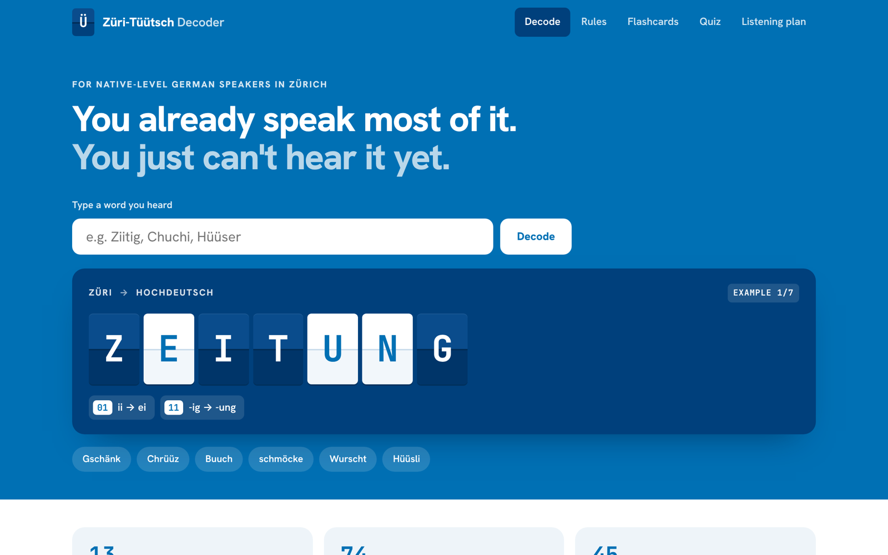

# Züri-Tüütsch Decoder

**My first GitHub project had to be about Züritüütsch.**

Turkish is my mother tongue, German my second home, and Swiss German the language my new neighbours speak. My German is native-level, yet in Zürich it suddenly needed subtitles. So, as a trained translator, I mapped how Hochdeutsch turns into Zürich German and built this little web app with Claude to practise hearing it in reverse.

👉 **Try it live: https://cemreozertas.github.io/zueri-tuetsch/**



## The idea

Zürichdeutsch isn't a new language. It's Standard German run through about a dozen predictable sound shifts, plus a few hundred everyday words that don't follow any rule. Learn the shifts, memorise the words, and train the one skill that matters when you're listening: **reversing what you hear back into Standard German.**

## What's inside

| Tab | What it does |
|---|---|
| **Decode** | Type a word you heard and watch it flip into Standard German on a departure board. The letters that change light up, and each change links to the rule behind it. Words that aren't in the list get a best guess, made by running the rules backwards. |
| **Rules** | 13 numbered sound shifts (ei → ii, au → uu, k → ch, -ung → -ig …), each with examples, a "reverse it" tip and its exceptions. Plus four grammar shortcuts. |
| **Flashcards** | 70+ words the rules can't explain (*luege, poschte, Rüebli, Ziischtig*), including false friends like *springe* = rennen. You can flip the direction, filter by topic, and your progress is saved in your browser. |
| **Quiz** | Read the dialect, type the Standard German, and see the answer flap into place with the rules that did the work. Two levels: words and sentences. |
| **Listening plan** | A step-by-step plan from SRF Meteo to Swiss TV series, plus one daily habit. |


## Design

The look borrows from the split-flap departure board and uses Zürich's city colours: **Blau** with white as the main pair, **Dunkelblau** for the flaps, **Türkis** for right answers, **Magenta** for misses and **Bordeaux** for exceptions and false friends. The fonts are Hanken Grotesk and JetBrains Mono, both served from this repo.

## How it's built

It's plain HTML, CSS and JavaScript, with no framework, no build step and no tracking. All the content lives in **one file**, [`data.js`](data.js), separate from the app logic:

```
index.html     page structure and the five tabs
styles.css     look and feel
app.js         split-flap board, decoder, flashcards, quiz
data.js        all rules, words, quiz items and the listening plan
fonts/         self-hosted fonts (SIL Open Font License)
docs/          screenshots for this README
```

The site is hosted for free with **GitHub Pages**, straight from the `main` branch.

## Run it on your own computer

Download or clone the repo and open `index.html` in your browser.

## Add a word or a rule

Open `data.js` and add a line to the right list, for example:

```js
{ zd: "Chäschtli", hd: "Kästchen", cat: "everyday" },
```

Got a correction or a favourite word? [Open an issue](../../issues) or send a pull request.

## A note on spelling

Swiss German has no official spelling. This app follows common Zürich usage, with long vowels written double (*Huus, Ziit*). You'll see other spellings in the wild, and other cantons sound different again (Bern says *nid*, not *nöd*).

## Credits

Made with love in Zürich by Cemre, built together with [Claude](https://claude.ai). Fonts: [Hanken Grotesk](https://github.com/marcologous/hanken-grotesk) and [JetBrains Mono](https://github.com/JetBrains/JetBrainsMono), both under the SIL Open Font License.

Licensed under the [MIT licence](LICENSE): free to use, copy and adapt.
