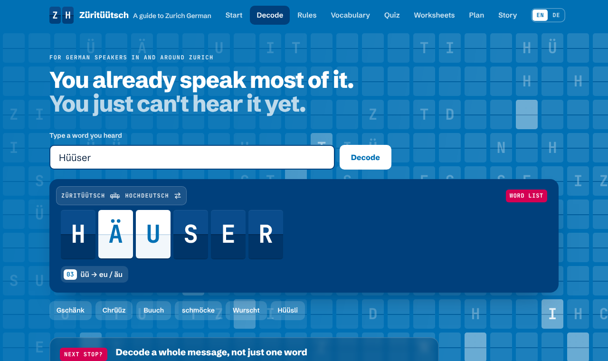
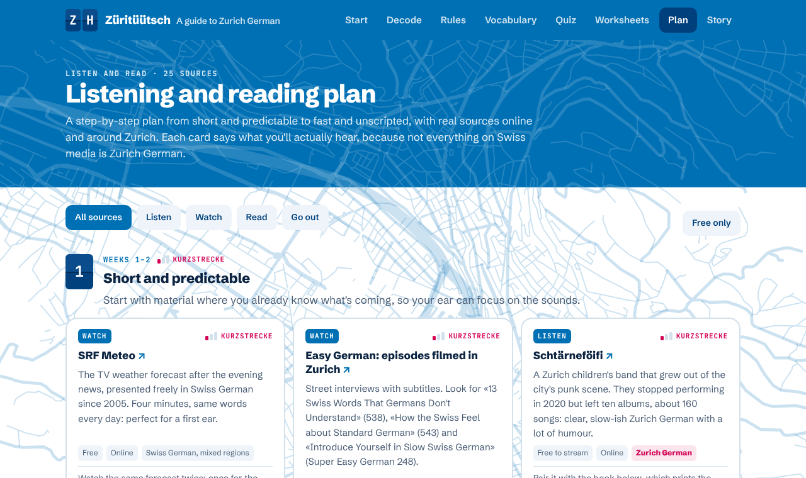
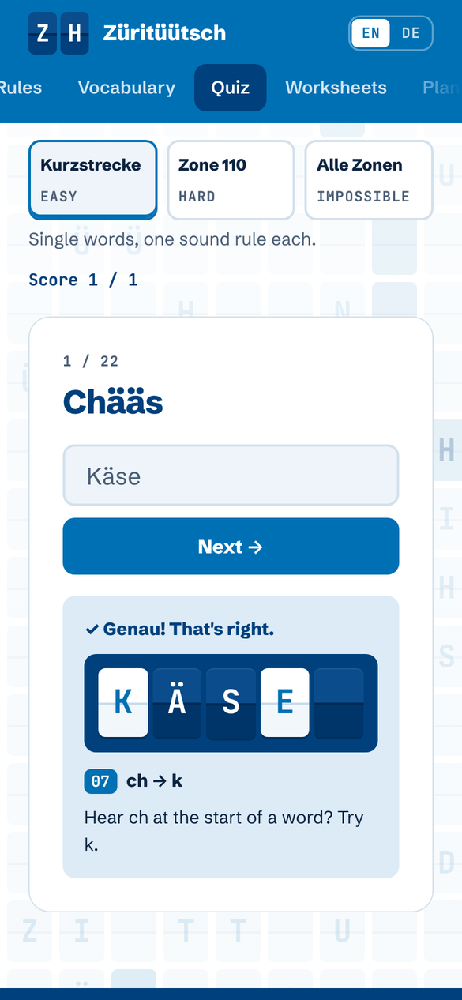
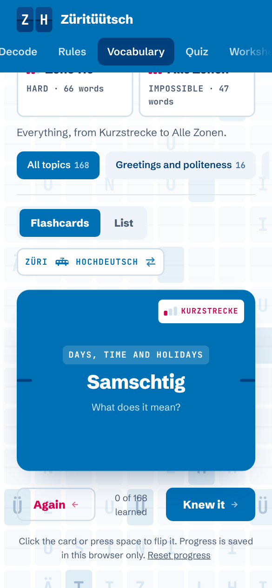
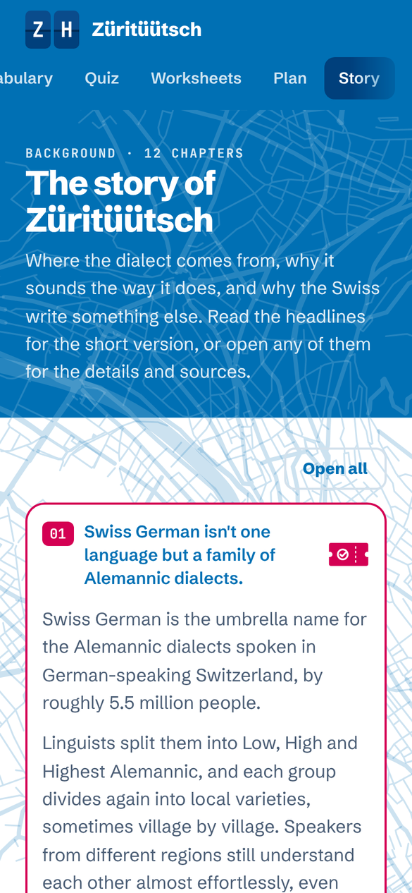

# Züritüütsch

*A guide to Zurich German*

**You already speak most of it. You just can't hear it yet.**

Turkish is my mother tongue, German my second home, and Zurich German the language my new neighbors speak. My German is native-level, yet in Zurich I suddenly needed subtitles. So I started listening very closely, and noticed that I could pick up more and more words once I knew how their sounds line up with Hochdeutsch: *Ziit* is *Zeit*, *Huus* is *Haus*, *Chind* is *Kind*. As a trained translator, I couldn't leave those patterns scattered in my head, so I collected them and built this little web app with Claude. It has been my own practice tool ever since, and it's here for anyone who wants to hear and speak Zurich German faster.

👉 **Try it live: https://cemreozertas.github.io/zueri-tuetsch/**

The site works on your laptop and your phone, and it speaks English and German: switch any time with **EN | DE** at the top right, or open the German version directly at [cemreozertas.github.io/zueri-tuetsch/de](https://cemreozertas.github.io/zueri-tuetsch/de/). Each language has its own address, so a shared link opens, and previews, in the right language.

📄 **Print the one-page cheat sheet** of the 13 sound shifts: [cheat-sheet.pdf](cheat-sheet.pdf), free to print and share (in German: [cheat-sheet-de.pdf](cheat-sheet-de.pdf)).


## The idea

Zurich German isn't a variant of Standard German but its close relative: both grew out of medieval German, and many of their sounds still line up in regular ways. (For the vowels, it was actually Standard German that changed, while Zurich German kept the older sound.) Learn about a dozen of these patterns, memorize the everyday words that follow no pattern at all, and train the skill that matters most when you're listening: **turning what you hear back into words you already know.** The decoder also works the other way around, from Hochdeutsch to Züritüütsch, for when you want to say something.

**Who it's for:** anyone in or around Zurich who speaks German. It works best if you're comfortable in Standard German (Hochdeutsch, about B1 and up), because the trick is reversing dialect into words you already know.

**For linguistically curious minds:** you don't need to speak German to enjoy this site. Zurich German still carries many sounds that Standard German left behind centuries ago, and the site makes those shifts visible. Scroll through the 13 sound shifts, decode a few words on the departure board and see the pattern for yourself. Come for one word, stay for a thousand years of language history.

## What's inside

| Tab | What it does |
|---|---|
| **Start** | Try the decoder straight away with a word you heard, then follow "Your first 15 minutes": decode three words, read the first five sound shifts and play one quiz round. |
| **Decode** | Type a word you heard and watch it flip into Standard German on a departure board. The letters that change light up, and each change links to the rule behind it. Words that aren't in the list get a best guess from the rules. A switch flips the direction, so you can also go from Hochdeutsch to Züritüütsch. |
| **Rules** | 13 numbered sound shifts (ei → ii, au → uu, k → ch, -ung → -ig …), each with examples, a "reverse it" tip and its exceptions. Plus four grammar shortcuts and a one-page cheat sheet to print as a PDF. |
| **Vocabulary** | 168 words and phrases the rules can't explain (*luege, poschte, Rüebli, Ziischtig*), sorted into ten topics and three levels named after Zurich's tram tickets: *Kurzstrecke* (easy), *Zone 110* (hard) and *Alle Zonen* (impossible). Practice them as flashcards (in either direction, with progress saved in your browser) or browse them as a list. False friends like *springe* = rennen get their own topic. |
| **Quiz** | Read the dialect, type the Standard German, and see the answer flap into place with the rules that did the work. The same three ticket levels: Kurzstrecke (single words), Zone 110 (trickier words and short sentences) and Alle Zonen (full sentences with slang). Each round has ten questions and ends with a ticket showing your score, ready to copy or share (Wordle style, with a link back). |
| **Worksheets** | Nine original texts in Zurich German, three per level: from ordering in a café (Kurzstrecke) to moving house (Zone 110) and a phone call full of slang (Alle Zonen). Each comes with six kinds of exercises: comprehension, decoding, matching, gap-fill, a listening task with a real source, and your own writing. Check answers on screen (saved in your browser) or print a clean A4 sheet with an optional answer key. |
| **Learning plan** | A learning plan in four stages, with 25 checked sources online and around Zurich: SRF Meteo, regional news, Neumatt, TeleZüri, Bligg, the Märchenbühne, the PBZ Schweizerdeutsch-Café, Zurich German books and more. Each source says honestly which dialect you'll hear. |
| **Story** | Where Zurich German comes from, in twelve short headlines you can open for details: the Alemanni, the old vowels, why the Swiss write Hochdeutsch, the missing ß, no official spelling and more. Every fact links to its source. |

<p>
  
  
</p>

<p align="center">
  &nbsp;
  &nbsp;
  
</p>

## Design

The look borrows from the split-flap departure board and uses Zurich's city colors, over a street map of Zurich from Oerlikon to Enge that stays still while the page scrolls. Every tab opens with a blue band. The three levels are named after Zurich's tram tickets: a short hop, the whole city, the whole canton. The practice pages (Decode, Vocabulary, Quiz and Worksheets) use a wall of faint split-flap tiles instead of the map, which now and then flip to a new letter. The colors come from the City of Zurich's palette: **Blue** with white as the main pair, **Dark Blue** for the flaps, and **Magenta** as the one accent color: for levels, wrong answers, exceptions and false friends, the numbers and the "Why this exists" bar on the Start page, and the story chapter you're reading. Right answers are light blue, and so are the cards and boxes across the site. The quiz sits on a dark blue card, like the decoder's departure board. The fonts are Schibsted Grotesk and JetBrains Mono, both served from this repo. Schibsted Grotesk is a sturdy newspaper grotesque in the spirit of Swiss poster type, and the same font is used across all of Cemre's Zurich projects.

## How it's built

It's plain HTML, CSS and JavaScript, with no framework, no build step and no cookies. Visits are counted anonymously with [GoatCounter](https://www.goatcounter.com/), which stores no personal data. The decoder counts only which kind of result a lookup gets, never the word itself. The content lives in two files, [`data.js`](data.js) and [`worksheets.js`](worksheets.js), separate from the app logic:

```
index.html     page structure and the eight tabs
styles.css     look and feel
app.js         split-flap board, decoder, flashcards, quiz, worksheets, plan
data.js        all rules, words, quiz items, the story and the learning plan
worksheets.js  worksheet texts and exercises (copy one to add a new worksheet)
content-de.js  the German version of every text (anything missing here simply stays English)
de/index.html  the German address of the site, built from index.html (run `node tools/make-de.js` after changing index.html)
cheat-sheet.pdf  the one-page cheat sheet of the sound shifts (cheat-sheet-de.pdf in German)
tools/         the sources of the cheat sheets and preview images, and the script that builds de/index.html
map-on-*.svg   the Zurich street map, one color per background
og-image.png   the preview image that shows up when the link is shared (og-image-de.png in German)
fonts/         self-hosted fonts (SIL Open Font License)
docs/          screenshots for this README
```

The site is hosted for free with **GitHub Pages**, straight from the `main` branch.

## Run it on your own computer

Download or clone the repo and open `index.html` in your browser.

## Add a word or a rule

Open `data.js` and add a line to the right list, for example:

```js
{ zd: "Chäschtli", hd: "Kästchen", cat: "everyday" },
```

Got a correction or a favorite word? [Open an issue](../../issues) or send a pull request. The Rules and Vocabulary pages ask the same question: *hear it differently in your Kreis?*

## A note on spelling

Swiss German has no official spelling. The site follows common Zurich usage, with long vowels written double (*Huus, Ziit*). You'll see other spellings in the wild, and other cantons sound different again (Bern says *nid*, not *nöd*).

## Credits

[Cemre](https://github.com/cemreozertas) is a Zurich-based tinkerer at heart. She builds automations, templates and apps for creative minds who love a well-run life, with [Claude](https://claude.ai) as her building partner.

***Mit Liebi gmacht z Züri.***

The level names are borrowed from ZVV tickets; this project isn't affiliated with ZVV. Map data © [OpenStreetMap contributors](https://www.openstreetmap.org/copyright), via [EqualStreetNames Zürich](https://github.com/EqualStreetNames/equalstreetnames-zurich). Fonts: [Schibsted Grotesk](https://github.com/schibsted/schibsted-grotesk) and [JetBrains Mono](https://github.com/JetBrains/JetBrainsMono), both under the SIL Open Font License.

Licensed under the [MIT license](LICENSE): free to use, copy and adapt.
